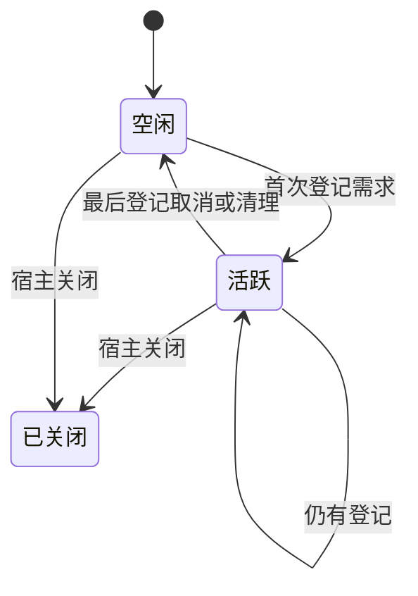

# 宿主按需运行

宿主公共服务保持统一实例，但周期任务按实际登记需求启动，最后一项登记清理后停止。固定间隔业务任务仍由原调度 API 管理。

## 统一调度

- 没有日历登记时，不创建分钟检查任务。
- 没有选主登记时，不创建续租心跳任务。普通日历任务不启动选主心跳，固定间隔选主也不启动日历检查。
- 首次启动对应检查不等待一个完整周期；后续维持每分钟日历检查、每 30 秒选主心跳。
- SQL 选主表在首次数据库选主时初始化，同一服务实例复用初始化结果。初始化失败不标记成功，后续使用时可重试。
- 执行检查与续租使用相同租约键。首次到期的日历任务可以获取尚不存在的租约，避免依赖心跳先执行；读取与获取租约分步释放连接，兼容单连接池。
- 取消旧句柄不会删除同键的新任务。关闭仍通过原有在途心跳完成信号收尾。

Redis/SQL 选主的原有不可用降级策略和租约时长保持不变。调度器实例仍属于一次宿主生命周期。

## 药水光环

- 初始化监听器时不创建空转刷新任务；首次有效来源登记后启动，退出、离线清理、最后来源移除或禁用后停止。
- 按玩家缓存不可变的合并效果表，仅在来源内容变化时重建。稳定刷新直接使用已合并视图。
- 同类型效果继续取最大等级，来源登记后仍立即应用；移除较强来源时立即恢复其他来源。
- 外部强非 ambient 效果保护、瞬间效果过滤、等级钳制和原有清除判断保持。
- 相同刷新周期的配置重载不重建已有任务，周期改变时才重新调度。

公共 API 和 `potion-aura` 配置字段保持不变。药水 API 仍要求主线程调用。

## 全局桥接初始化与配置刷新

加载/校验多个模块仍可反复确认全局桥接就绪，但不应重复执行与配置变化无关的重活：

- 每轮全局桥接初始化共享同一份宿主 YAML 快照，货币/属性与审核配置使用一致的读取结果。
- 审核配置相同且 Redact 依赖未变化时，复用已有匹配规则和词库。只改本地规则不会重启云词库任务；只改刷新周期会保留已下载词库并更换任务。
- Redact 插件实例或可用状态变化仍会重新绑定，服务提供者也继续由原接口动态查询。
- 显式全量重载会立即安排一次云词库刷新，周期任务保持正常节奏。普通模块加载不再造成额外的立即拉取。
- 禁用审核、卸载全部或关闭宿主清理全局桥接时，旧词库周期任务会取消；旧配置排队中的刷新会检查当前状态，失效后不再开始下载。
- 奖励表初始化只在同一服务实例中成功后复用结果。创建/升级后先验证所需列，失败时保持可重试，不改变奖励存取、认领或账本逻辑。

审核与奖励服务的公共接口、配置字段、词库格式、奖励表结构和玩家数据格式保持不变。

## 验证口径

空闲后台任务数与集合聚合微基准可以验证此次改动减少了哪些工作，但不代表真实服务器 TPS、网络包或客户端帧率提升。多人、真实客户端和生产运行结果需要单独测量。
