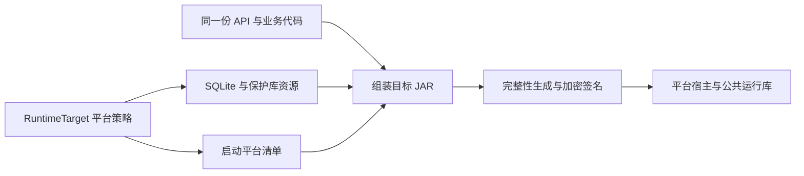

# 运行时资源与平台构件

各平台构件共用 Suite 宿主、API 和业务代码。平台选择决定 SQLite 与原生保护库的资源。发行包由宿主 JAR 和公共运行库组成，首次使用尚未缓存的运行库时需要联网。 [按需运行库](thin-runtime.md)



## 发行目标

| `axs.runtimeTarget` | 用途 | 保留资源 |
|---|---|---|
| `universal`（默认） | Windows 和 Linux 的本地开发构建 | Windows、Linux、Linux musl 的现有 SQLite 架构文件，以及两份保护库 |
| `windows-x86_64` | Windows 上的 x86_64 JVM | Windows x86_64 SQLite 与 Windows 保护库 |
| `linux-x86_64` | Linux 上的 x86_64 JVM | Linux glibc/musl x86_64 SQLite 与 Linux 保护库 |

平台专用包保留全部业务功能与数据库选项。主机/JVM 的 OS 或 CPU 与构件不匹配时，启动日志会提示改用正确构件或通用包，插件不会继续启用业务核心。

Linux musl 的 SQLite 文件保留不代表保护库新增了 musl 支持：保护库的 ABI、系统要求与 CI 构建产物一致。通用包也不新增其他 CPU 架构的保护库支持。

## 本地开发构建

```powershell
# 通用包及完整业务测试
.\gradlew.bat buildDev :axs-core:test :auth-engine:test

# 平台专用开发包；业务测试使用上面的通用运行时
.\gradlew.bat :axs-core:thinCoreJar '-Paxs.runtimeTarget=windows-x86_64'
.\gradlew.bat :axs-core:thinCoreJar '-Paxs.runtimeTarget=linux-x86_64'
```

通用包沿用 `axs-core/build/libs/`。专用构件分别位于 `axs-core/build/runtime/<target>/libs/`，文件名包含目标后缀，各子项目的构建输出也按目标隔离。构建检查是否包含对应的保护库；本地没有 native 的开发包不代表可部署的生产包。

平台策略集中在 `buildSrc/src/main/kotlin/RuntimeTarget.kt`，生成的 `META-INF/axs-runtime.properties` 同时供启动检查与发行校验器使用。增加目标时，应同步实现资源策略、启动平台校验、发行校验及测试。

## 加密生产构建

继续通过 `Encrypted CI Pipeline` 构建。`main` 推送和手动触发均使用 Windows/Linux 双平台矩阵，分别产生 `windows-x86_64` 和 `linux-x86_64` 核心。平台选择发生在 ProGuard、完整性生成、逐类加密与签名前，禁止对已经签名的通用包删除资源来制作生产专用包。

每个矩阵作业先以通用运行时执行业务测试，再构建对应平台的加密包并验证该目标所需的 native。两种构件使用独立 Artifact 和映射文件名；代理端使用独立作业，避免重复构建上传。

CI 将两个平台的宿主、运行库和正式模块暂存到两端云服务。宿主按平台上传，并与同批模块使用同一发布号。两端暂存完成后，主线推送触发整批激活。手动运行可构建并暂存，勾选 `skip_upload` 时只执行构建验证。

云端下载中心分别展示 Windows/Linux 构件，下载凭证绑定平台及版本 ID。平台专用包的上传会校验包内 `axs-runtime.properties`，禁止错投另一平台通道。通用包继续作为本地构建选项保留，云端 CI 不再发布通用核心。
